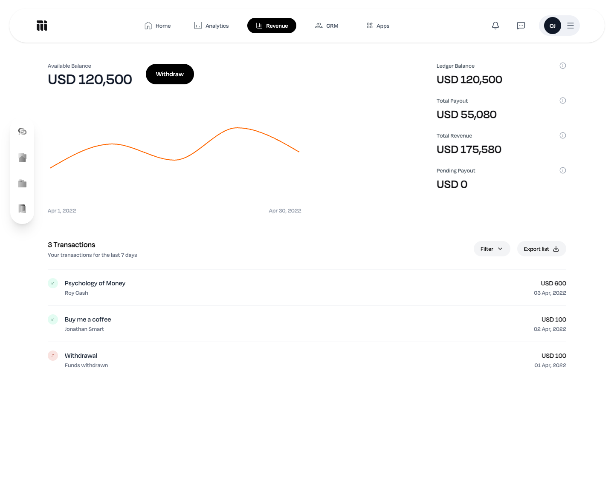

# Mainstack Revenue Dashboard

A React and TypeScript frontend for viewing a creator's wallet balance, revenue summary, and transaction history. The project explores dashboard composition, API integration, charts, and transaction filter controls.

[View the hosted demo](https://mainstack-dashboard-eta.vercel.app)



*The screenshot uses mocked API responses. The chart uses the sample series defined in the frontend.*

## Features

- Wallet summaries for available balance, ledger balance, revenue, and payouts.
- API-backed user details and transaction list, with deposit and withdrawal presentation.
- Revenue chart built with Recharts.
- Filter panel with date, transaction type, and status selections.
- App and profile dropdown menus.

The filter panel currently stores selections locally; applying them does not filter the transaction list. Withdraw and export controls are interface placeholders.

## Stack

React 19, TypeScript, Vite, Tailwind CSS, Axios, Recharts, and Lucide icons.

## Run locally

Use Node.js 24 and npm.

```bash
git clone https://github.com/okikioriola1/mainstack-dashboard.git
cd mainstack-dashboard
npm ci
cp .env.example .env.local
npm run dev
```

Set `VITE_API_BASE_URL` in `.env.local` to your API's base URL before starting Vite. The example `http://localhost:3001` is a configuration example; this repository does not include an API server. Open the URL printed by Vite. Restart Vite after changing environment variables.

### API contract

The frontend makes three GET requests relative to `VITE_API_BASE_URL`. Return JSON directly, without a wrapper object:

| Endpoint | Expected response |
| --- | --- |
| `/user` | Object with optional `first_name`, `last_name`, and `email` fields |
| `/wallet` | Object with numeric `balance`, `ledger_balance`, `total_payout`, `total_revenue`, and `pending_payout` fields |
| `/transactions` | Array of transactions with `amount`, `status`, `type` (`deposit` or `withdrawal`), and `date`; optional `metadata` and `payment_reference` |

See [the response types](src/api/types.ts) and [API client](src/api/revenueApi.ts). Enable CORS for the frontend origin when hosting the API separately. Vite exposes `VITE_` variables in the browser bundle, so use public configuration only.

## Checks

```bash
npm run lint
npm run build
npm run preview
```

GitHub Actions runs lint and production build checks on pushes and pull requests. There is currently no automated test suite.

## Code map

- `src/api/`: requests and shared response types.
- `src/pages/Dashboard/`: data fetching and dashboard layout.
- `src/components/`: navigation, summaries, transactions, filters, and date picker.
- `src/hooks/formatDate.ts`: transaction date formatting.

## Next improvements

Connect filters and export to transaction data, add loading and API error states, replace the sample chart with API data, and test the filtering workflow.
